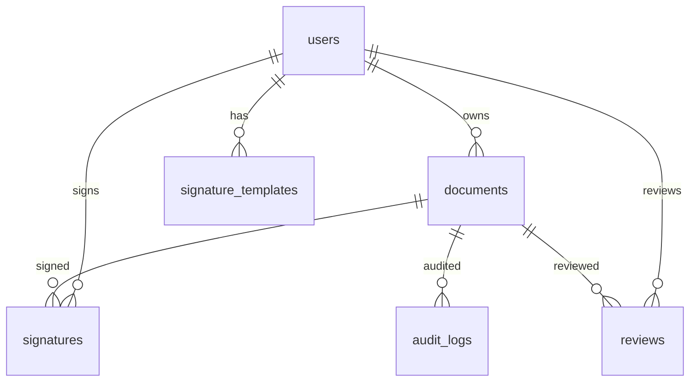

# Database Design

## Engine
**H2 file** — `jdbc:h2:file:./data/paperless;AUTO_SERVER=TRUE` (auto-created on first run). Swap to MySQL by changing one constant in `util/DBUtil.java`.

## Entity-Relationship

```
users 1 ── N documents        (owner_id)
users 1 ── N signature_templates
documents 1 ── N signatures
documents 1 ── N audit_logs
documents 1 ── N reviews
users 1 ── N signatures (signer_id)
users 1 ── N reviews    (reviewer_id)
```

## Tables (DDL in `DBUtil.initDatabase()` — idempotent)

### users
| Column | Type | Notes |
|---|---|---|
| id | INT PK AUTO_INCREMENT | |
| name | VARCHAR(100) NOT NULL | |
| email | VARCHAR(150) UNIQUE NOT NULL | validator checked |
| password_hash | VARCHAR(256) | SHA-256 |
| role | VARCHAR(20) | ADMINISTRATOR / SIGNER / REVIEWER |
| active | BOOLEAN | deactivation |
| created_at, updated_at | TIMESTAMP | BaseEntity |

### documents
| Column | Type | Notes |
|---|---|---|
| id | INT PK | |
| title | VARCHAR(255) NOT NULL | |
| content | CLOB | document body (file_path for uploads) |
| file_path | VARCHAR(500) | optional attachment |
| status | VARCHAR(30) | DRAFT / PENDING_SIGNATURE / SIGNED / REVIEWED / REJECTED |
| owner_id | INT FK → users(id) | |
| compliance_status | VARCHAR(20) | PENDING / COMPLIANT / NON_COMPLIANT |
| created_at, updated_at | TIMESTAMP | |

### signature_templates
| Column | Type | Notes |
|---|---|---|
| id | INT PK | |
| name | VARCHAR(100) | |
| signature_data | CLOB | styled text / base64 |
| user_id | INT FK → users | owner |
| is_default | BOOLEAN | |
| created_at, updated_at | TIMESTAMP | |

### signatures
| Column | Type | Notes |
|---|---|---|
| id | INT PK | |
| document_id | INT FK → documents | |
| signer_id | INT FK → users | |
| template_id | INT FK (nullable) | |
| signature_hash | VARCHAR(500) | integrity hash |
| signed_at, ip_address | TIMESTAMP / VARCHAR(45) | traceability |
| created_at, updated_at | TIMESTAMP | |

### audit_logs
| Column | Type | Notes |
|---|---|---|
| id | INT PK | |
| action | VARCHAR(100) | CREATE_DOCUMENT / SIGN / REVIEW / STATUS_CHANGE |
| user_id | INT | |
| document_id | INT | |
| details | CLOB | |
| timestamp, created_at, updated_at | TIMESTAMP | |

### reviews
| Column | Type | Notes |
|---|---|---|
| id | INT PK | |
| document_id | INT FK → documents | |
| reviewer_id | INT FK → users | |
| comments | CLOB | |
| compliance_status | VARCHAR(20) | |
| approved | BOOLEAN | |
| reviewed_at, created_at, updated_at | TIMESTAMP | |

## Seed Data
`initDatabase()` inserts 3 demo users if table empty:
- `admin@paperless.com / admin123` → ADMINISTRATOR
- `alice@paperless.com / signer123` → SIGNER
- `bob@paperless.com / reviewer123` → REVIEWER

## JDBC Usage
- `DBUtil.getConnection()` → `DriverManager.getConnection(URL, sa, "")`
- All DAOs use `PreparedStatement` + `try-with-resources` + `ResultSet` mapping.
- Verified by `PaperlessTest` (15 tests) hitting real H2 file DB.

## Mermaid ER


